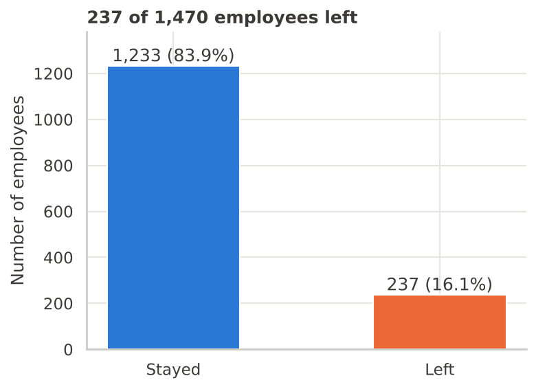
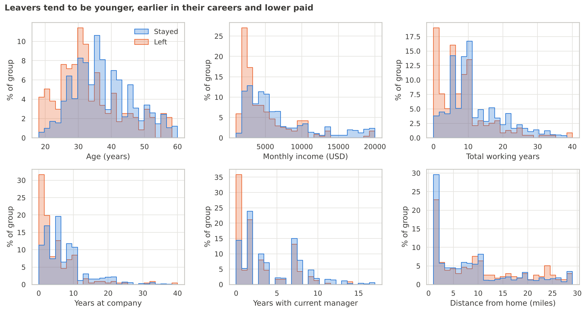
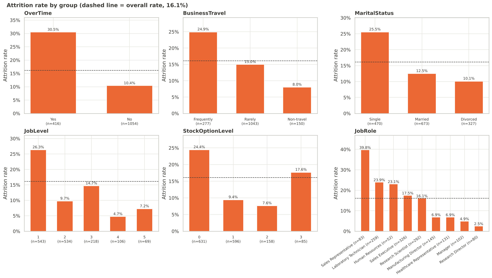
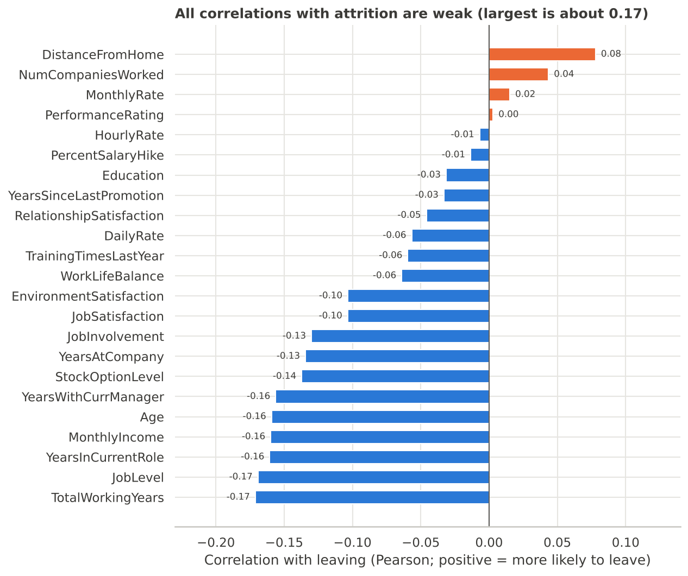
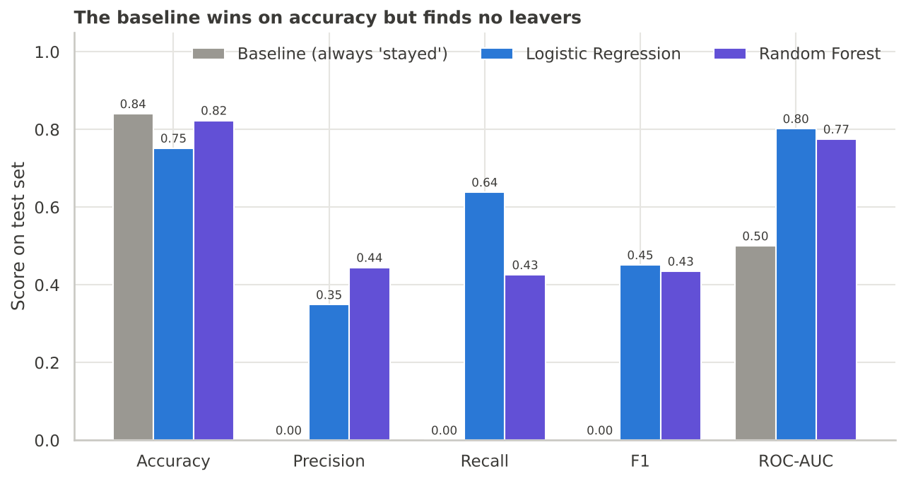
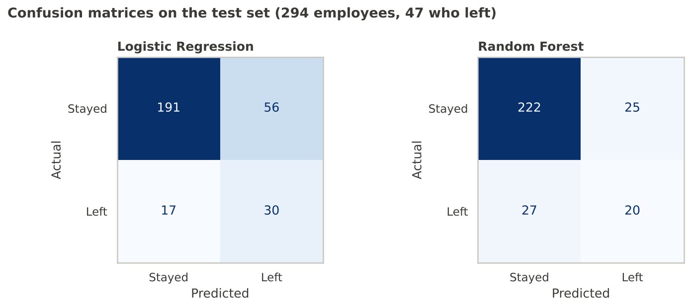
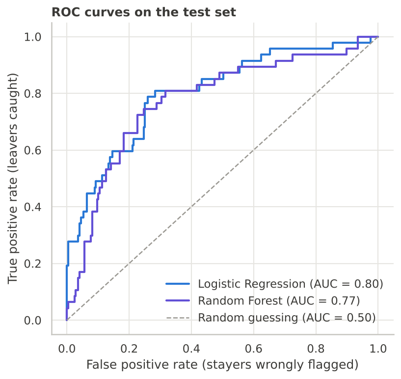
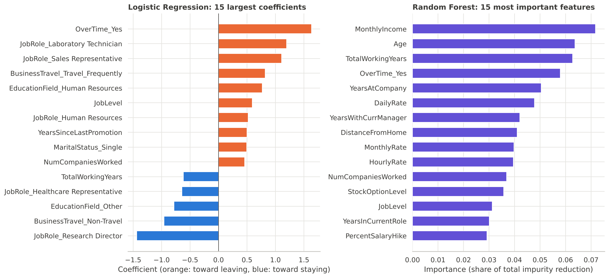

# Employee Attrition Prediction

A data science project that looks at which employees are more likely to leave an organization, and how well a simple machine learning model can predict it. It uses the public IBM HR Analytics attrition dataset (1,470 employees, 16.1% of whom left) and covers the full workflow: exploratory analysis, a majority-class baseline, Logistic Regression and Random Forest models, evaluation with metrics suited to imbalanced data, and an honest discussion of what the results can and cannot tell us.

Everything is in one notebook: [`notebooks/employee_attrition_analysis.ipynb`](notebooks/employee_attrition_analysis.ipynb). The numbers in this README come from running that notebook.

---

## 1. The business problem

Employee attrition is when people leave an organization. Each departure has a cost: recruiting and training a replacement, the weeks or months before that person is fully productive, and the knowledge that walks out the door. A company that understands where attrition is concentrated can look at those areas more closely.

A prediction model might help with that, but it is not a solution on its own. It can flag groups or individuals who look similar to past leavers. It cannot say *why* anyone leaves, and using it to make decisions about individual people raises fairness and privacy questions (see [section 12](#12-limitations-and-responsible-use)).

## 2. Objectives and questions

1. **Understanding the problem.** What is attrition, why does it matter, and what can data tell us about it?
2. **Analyzing the data.** Which employee characteristics are associated with leaving?
3. **Predicting attrition.** Can we predict which employees will leave, how reliable are the predictions, and where does the model fall short?

The project keeps three ideas apart: a *correlation* (two things appear together in the data), *predictive usefulness* (a feature helps a model guess the outcome), and *causation* (one thing makes the other happen). The data here can show the first two. It cannot show the third.

## 3. Dataset

| | |
|---|---|
| **Name** | IBM HR Analytics Employee Attrition & Performance |
| **Nature** | A *fictional* dataset created by IBM data scientists (described that way on its IEEE DataPort listing). It is not data from a real company. |
| **File used** | `data/raw/employee_attrition.csv`, downloaded from IBM's GitHub repository: <https://raw.githubusercontent.com/IBM/employee-attrition-aif360/master/data/emp_attrition.csv> |
| **Most widely used public page** | Kaggle: <https://www.kaggle.com/datasets/pavansubhasht/ibm-hr-analytics-attrition-dataset>. This page could not be opened from the environment where the project was built, so the IBM repository copy was used. |
| **Size** | 1,470 rows, 35 columns. No missing values, no duplicate rows. |
| **Target** | `Attrition` (Yes = left, No = stayed): 237 left (16.1%), 1,233 stayed (83.9%) |
| **Features** | Demographics (age, gender, marital status, education), job details (role, level, department, overtime, business travel), pay (monthly income, salary hike, stock options), tenure (years at company, in role, with manager, since promotion), and 1-to-4 survey ratings (job satisfaction, work-life balance, and others) |
| **Usage terms** | The IBM repository's page lists its *code* under Apache 2.0 and the *dataset* under the Open Database License (ODbL) with the Database Contents License (DbCL). Secondary sources describe the terms as loosely specified but free for educational use. Check the repository page before reusing the data outside this portfolio project. |

The raw file's contents are unchanged: the only edit was removing an invisible UTF-8 byte-order mark from the start of the file, so the first column name reads as `Age` instead of a garbled string. Cleaning happens on a copy inside the notebook.

### Why this dataset

Two candidates were looked at in some detail:

| Candidate | What was found | Decision |
|---|---|---|
| **IBM HR Analytics** (selected) | Single CSV, 1,470 rows, a clear Yes/No target, a mix of numeric and categorical features, widely documented, and available from IBM's own repository. | Selected |
| **Kaggle "HR Analytics" (a company of about 4,000 employees)** | Only secondhand descriptions were found (about 4,000 employees, around 15% attrition). The Kaggle page could not be opened, so its structure, documentation and terms could not be checked. | Not used: could not be verified |

Other small HR datasets exist (a roundup article lists several), but none were examined closely.

The IBM dataset is the most common attrition dataset in student projects, so choosing it does not set this project apart by itself. What it offers is a manageable size and some realistic teaching problems: imbalanced classes, constant columns, an ID column, overlapping features, and a small test set. Those are good places to show care with evaluation.

### Dataset limitations

- It is fictional, so findings cannot be assumed to hold at a real company.
- It is a single snapshot: no dates, no reasons for leaving, and no distinction between voluntary and involuntary exits.
- It does not document when the survey-type columns were recorded relative to the departure.
- `DailyRate`, `HourlyRate` and `MonthlyRate` are essentially uncorrelated with `MonthlyIncome` (0.01, -0.02, 0.03), which would be unusual in real payroll data and is another sign of synthetic data.

## 4. Project structure

```
employee-attrition-prediction/
├── README.md
├── requirements.txt
├── .gitignore
├── notebooks/
│   └── employee_attrition_analysis.ipynb   # full analysis, executed
├── data/
│   └── raw/
│       └── employee_attrition.csv          # original dataset, untouched
└── charts/                                 # every chart used below, saved by the notebook
    ├── 01_attrition_distribution.png
    ├── 02_numerical_feature_distributions.png
    ├── 03_categorical_attrition_comparison.png
    ├── 04_correlation_analysis.png
    ├── 05_model_performance_comparison.png
    ├── 06_confusion_matrix.png
    ├── 07_roc_curve.png
    └── 08_feature_importance.png
```

There is no `data/processed/` folder because the cleaned data is small and is recreated in a few lines inside the notebook.

## 5. Methodology

1. Load the raw data and inspect it (shape, types, missing values, duplicates, target balance).
2. Check data quality and remove only columns with a clear reason to go.
3. Explore the data with attrition *rates* by group (not raw counts) and with distributions of numeric features.
4. Split into training (80%) and test (20%) sets, stratified on the target, **before** any preprocessing is fitted.
5. Put preprocessing and model together in a scikit-learn `Pipeline`, so scaling and encoding learn only from training data.
6. Build a "predict stayed for everyone" baseline.
7. Compare Logistic Regression and Random Forest using 5-fold cross-validation on the training set only, with the selection rule written down before looking at results.
8. Evaluate once on the held-out test set, and use a bootstrap to estimate how noisy those numbers are.
9. Interpret the models and state their limits.

## 6. Key findings from the exploratory analysis

### How common is attrition?



237 of 1,470 employees (16.1%) left, so the classes are imbalanced about 5 to 1. This shapes the whole modeling approach: a model that always says "stayed" would be right 84% of the time while finding nobody who leaves.

### Leavers are younger, earlier in their careers and paid less



The median leaver is 32 years old, has 7 total working years, 3 years at the company, 2 years with their current manager and earns about USD 3,200 a month. The median stayer is 36, with 10 working years, 6 years at the company, 3 years with their manager and about USD 5,200 a month. The distributions overlap a lot, and these features move together, so they mostly describe one pattern ("early-career employees leave more often") from several angles. Distance from home shows a smaller difference (median 9 miles for leavers, 7 for stayers).

### Some groups leave far more often than others



- **Overtime:** 30.5% of employees working overtime left, against 10.4% of those who did not.
- **Job role:** Sales Representatives left at 39.8% (n=83) and Laboratory Technicians at 23.9%, while Research Directors (2.5%) and Managers (4.9%) rarely left.
- **Job level:** 26.3% at level 1, against 4.7% to 14.7% at levels 2 to 5.
- **Stock options:** 24.4% with none, against 9.4% and 7.6% at levels 1 and 2. Level 3 is 17.6%, but it covers only 85 employees, so it may be noise.
- **Travel and marital status:** 24.9% of frequent travellers left versus 8.0% of non-travellers, and 25.5% of single employees versus 10.1% to 12.5% of divorced and married ones.

Role and level are tangled together: 76 of the 83 Sales Representatives are level 1. Overtime is not just a level effect, though, since the share working overtime is similar at every level (26% to 31%).

### Individual numeric correlations are weak



No numeric feature has a correlation with leaving larger than 0.17 in size. Several features are strongly correlated with each other (`JobLevel` and `MonthlyIncome` at 0.95, for example), which makes it hard to separate their individual effects. The strongest signals, overtime and job role, are categorical and do not appear on this chart.

## 7. Data preparation decisions

- **Dropped `EmployeeCount`, `Over18`, `StandardHours`:** each has one value for every employee, so they cannot distinguish leavers from stayers.
- **Dropped `EmployeeNumber`:** it is a row identifier with no business meaning.
- **Kept everything else:** there were no missing values or duplicates to handle, and consistency checks (for example tenure columns exceeding total working years) found nothing impossible. This leaves 30 input features: 23 numeric and 7 categorical.
- **Ordinal codes kept as numbers:** ratings like `JobSatisfaction` (1 to 4) and `JobLevel` stay numeric. This is simple and keeps their order, but a linear model then assumes equal steps, which the stock option pattern shows is not always true.
- **Scaling and one-hot encoding inside the pipeline:** numeric features are standardized and categorical ones one-hot encoded, with both steps fitted on training data only. Binary columns such as `OverTime` become a single 0/1 column.
- **Split:** 1,176 training employees (190 left, 16.2%) and 294 test employees (47 left, 16.0%).

No new features were engineered. With 30 existing features and a small dataset, adding more would have made the project harder to explain without a clear reason.

## 8. Baseline and models

**Baseline.** A `DummyClassifier` that always predicts "stayed" scores **84.0% accuracy** on the test set and finds none of the 47 leavers (recall 0, ROC-AUC 0.50). Any useful model has to beat this on recall and ROC-AUC, not on accuracy.

**Logistic Regression.** Fits a weighted sum of the features and converts it to a probability. Simple, quick and easy to explain, but it can only capture straight-line effects.

**Random Forest.** Averages many decision trees. It can capture non-linear effects and interactions, but is harder to explain and can overfit a small dataset. It uses 300 trees and `min_samples_leaf=3`.

**Class imbalance.** Both final models use `class_weight="balanced"`, which makes mistakes on leavers count more during training. No oversampling was used. Cross-validation on the training set shows what this does:

| Model (5-fold CV, training set) | ROC-AUC | Recall | Precision | F1 |
|---|---|---|---|---|
| Logistic Regression (balanced) | 0.827 | 0.737 | 0.371 | 0.492 |
| Logistic Regression (no weights) | 0.839 | 0.432 | 0.782 | 0.553 |
| Random Forest (balanced) | 0.807 | 0.432 | 0.541 | 0.471 |
| Random Forest (no weights) | 0.812 | 0.200 | 0.828 | 0.314 |

Weighting does not improve how well employees are *ranked* (ROC-AUC barely moves). It moves each model towards flagging more employees: recall goes up and precision goes down. That is a trade-off, not a free gain. The balanced versions were kept because missing a leaver was judged worse than a false alarm for this problem; if false alarms were costly, the unweighted models would be a reasonable choice.

**Choosing between the two model types.** The rule, set before looking at results, was the higher cross-validated ROC-AUC, which favoured Logistic Regression (0.827 versus 0.807). The gap is smaller than the fold-to-fold spread (about 0.03), so the two are close, and no hyperparameter search was run.

## 9. Evaluation results

What the metrics mean here, with "left" as the positive class:

- **Accuracy:** share of all employees classified correctly. Misleading when 84% of employees stay.
- **Precision:** of the employees flagged as likely to leave, the share who actually left.
- **Recall:** of the employees who actually left, the share that were flagged.
- **F1:** a single number balancing precision and recall.
- **ROC-AUC:** how well the predicted probabilities rank leavers above stayers. 0.5 is a coin flip, 1.0 is perfect.

### Test set results (294 employees, 47 of whom left)

| Model | Accuracy | Precision | Recall | F1 | ROC-AUC |
|---|---|---|---|---|---|
| Baseline (always "stayed") | 0.840 | 0.000 | 0.000 | 0.000 | 0.500 |
| Logistic Regression | 0.752 | 0.349 | 0.638 | 0.451 | 0.802 |
| Random Forest | 0.823 | 0.444 | 0.426 | 0.435 | 0.775 |



The baseline has the highest accuracy and the lowest usefulness. Logistic Regression gives up accuracy to find more leavers (recall 0.64). The Random Forest is more cautious: higher precision and accuracy, lower recall, and an F1 close to the logistic regression's.



In concrete terms, Logistic Regression flags 86 employees (29% of the test set): 30 did leave and 56 did not, and 17 of the 47 leavers were missed. The Random Forest flags 45 employees: 20 left and 25 did not, and 27 leavers were missed. With one employee in six leaving overall, a precision of 0.35 is roughly twice as good as flagging people at random, but about two in three flagged employees would still have stayed.



Both curves sit clearly above the diagonal "random guessing" line, which means both models rank leavers above stayers much better than chance. They are close to each other.

### How much to trust these numbers

The test set contains only 47 leavers. Resampling it 1,000 times (bootstrap) gives these rough 95% intervals:

| Model | Recall | ROC-AUC |
|---|---|---|
| Logistic Regression | 0.50 to 0.78 | 0.73 to 0.87 |
| Random Forest | 0.28 to 0.57 | 0.69 to 0.84 |

The intervals are wide, and the ROC-AUC ranges overlap almost completely. Logistic Regression looks better on recall, but the evidence is suggestive rather than conclusive. During development, a small change in how binary columns were encoded moved the Random Forest's test recall by several points, which is another sign of how unstable results are at this sample size. An ROC-AUC around 0.80 is reasonable for this kind of problem, but not accurate enough to make decisions about individual employees.

## 10. Model interpretation



**Logistic Regression** (left): the largest coefficient is `OverTime_Yes` (+1.63), which corresponds to roughly five times the odds of leaving, with other features held fixed. Research Directors (-1.44) are much less likely to leave, while Laboratory Technicians (+1.20) and Sales Representatives (+1.11) are more likely. Frequent travel (+0.82), no travel (-0.96), being single (+0.49), years since last promotion (+0.50) and number of previous employers (+0.46) also matter.

**Random Forest** (right): the most important features are `MonthlyIncome`, `Age`, `TotalWorkingYears`, `OverTime_Yes` and `YearsAtCompany`. Importance is spread thinly; the top three features account for only about 20% of the total.

The two views share `OverTime_Yes` near the top but otherwise stress different things: the forest favours age, income and tenure, the logistic regression favours role, travel and overtime. This is not necessarily a contradiction, since age, income, level and tenure overlap heavily and a linear model splits their combined effect among them.

Two cautions from the chart:

- `JobLevel` has a *positive* coefficient (+0.60) even though level 1 employees leave the most in the raw data. This is most likely a side effect of its 0.95 correlation with `MonthlyIncome`, and shows why individual coefficients should not be over-read when features overlap.
- `DailyRate`, `MonthlyRate` and `HourlyRate` all rank in the forest's top ten even though they look like noise. Impurity-based importance can reward continuous features simply because they offer many split points. Permutation importance was not run to check this.

Importance scores and coefficients describe patterns in historical data. They do not show that overtime *causes* people to leave, and they say nothing about any individual's reasons.

## 11. Recommendations

These come from associations in a fictional dataset, so they are questions an HR team might ask of its own data rather than conclusions:

1. **Look at overtime.** It is the clearest single pattern (30.5% versus 10.4%) and is not explained by job level. Check whether it is voluntary, how it is compensated, and which teams carry most of it.
2. **Review the junior sales and laboratory roles,** where attrition is highest: pay progression, promotion paths and workload.
3. **Look at early-career retention,** such as onboarding and mentoring, since the median leaver had about 3 years at the company.
4. **Look at how much frequent travel is required** and whether it is shared fairly.
5. **If a model like this is used at all,** use it to prioritize group-level reviews rather than to decide anything about individuals, and validate it on the organization's own data first.

## 12. Limitations and responsible use

- **Fictional, single-snapshot data.** No dates, no reasons for leaving, and no voluntary versus involuntary distinction.
- **Possible timing problem.** If any survey-type column was recorded after an employee decided to leave, a real model would not have that information in advance.
- **Small sample.** 237 leavers in total and 47 in the test set, evaluated on a single split. All performance numbers are noisy.
- **Sensitive attributes.** The model uses `Age`, `Gender` and `MaritalStatus`. Using predictions like these to make individual employment decisions could be unfair or unlawful in some places, and no fairness audit was done.
- **Overlapping features.** Strong correlations make individual coefficients and importances hard to interpret, and some columns look like noise.
- **Not a decision tool.** At the chosen operating point, most flagged employees are not leavers, and several leavers are missed.

## 13. How to install and run

Requires Python 3. The notebook runs top to bottom in under a minute. The results above were produced with Python 3.13 and these package versions: pandas 3.0.5, NumPy 2.5.3, scikit-learn 1.9.1, matplotlib 3.11.2, seaborn 0.13.2. Results may differ slightly with other versions.

```bash
git clone <your-repository-url>
cd employee-attrition-prediction

python -m venv .venv
source .venv/bin/activate        # Windows: .venv\Scripts\activate
pip install -r requirements.txt

jupyter notebook notebooks/employee_attrition_analysis.ipynb
```

Then choose *Run All*. The notebook finds the data and chart folders itself (it works whether it is started from the project root or from `notebooks/`), uses random seed 42, and rewrites the charts in `charts/`.

## 14. Lessons and possible improvements

**What the results illustrate**

- Accuracy can be misleading with imbalanced classes: the do-nothing baseline scored highest on accuracy and found no leavers.
- Class weighting changes where a model operates (more flagged employees, more false alarms) rather than how well it ranks them.
- With 47 positive cases in the test set, the difference between two reasonable models can fall within the noise.
- Overlapping features make model coefficients and importance scores hard to read on their own, and they should be set against the exploratory analysis.

**Possible improvements**

- Repeated cross-validation instead of a single split, for more stable estimates.
- Choose the decision threshold from the relative cost of missed leavers and false alarms.
- Use permutation importance to check the forest's rankings.
- Try gradient boosting, group rare categories, and remove or combine overlapping features.
- Audit the model for fairness across age, gender and marital status.
- Repeat the analysis on a dataset with tenure and timing information, which would allow survival analysis.
